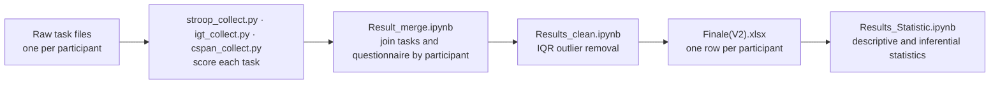

# Does gaming sharpen the mind? Video-game play and executive function

BSc Psychology dissertation · Durham University · 2021 · mark **72%** · supervisor Dr Ulrik Beierholm

*Differentiating executive improvement in young adults induced by exposure to distinct categories of the video game*

**Question:** Is weekly play time in different categories of video game linked to executive function in young adults?

| | |
|---|---|
| Design | Online battery (PsyToolkit, Nov–Dec 2020): a video-game play questionnaire, then three cognitive tasks |
| Participants | Adults aged 18–25; 144 questionnaire responses, 123–126 per task |
| Questionnaire | Weekly hours in 9 game categories (e.g. shooters, real-time strategy/MOBA, puzzle, sports/driving, plus "others"), for the past 12 months and for earlier |
| Tasks | Stroop (inhibition), Iowa Gambling Task (decision-making under risk and ambiguity), Corsi block (visuospatial working memory) |
| Analysis | Python scripts score each task; notebooks merge the data, remove outliers (IQR) and test associations (Spearman correlations, ANOVA, Kruskal-Wallis, Mann-Whitney) |

## Pipeline

## What you can re-run

- **Statistics:** `Results_Statistic.ipynb` reads `Finale(V2).xlsx`, the cleaned final dataset in this repository.
- **Task scoring:** the three `*_collect.py` scripts run on the raw files in `Final Data unpacked/` once you change the `path` variable at the top of each script (it still points to the original Windows folder).
- **Merging and cleaning:** `Result_merge.ipynb` and `Results_clean.ipynb` document these steps, but they read intermediate spreadsheets that are not included, so they show the method rather than run end to end.

Participants consented to their data being shared. The files contain no full names or contact details.

## Folder guide

| Path | Contents |
|---|---|
| `Final Data unpacked/stroop/`, `igt_test/`, `corsi_block/` | Raw task data, one file per participant |
| `Final Data unpacked/s_question/` | Raw questionnaire data, one file per participant |
| `Final Data unpacked/data.xlsx` (`.csv`) | Questionnaire responses (video-game play), one row per participant |
| `Final Data unpacked/data_times.xlsx` (`.csv`) | Time spent on each questionnaire section |
| `Final Data unpacked/stroop_complete.xlsx`, `igt_complete.xlsx`, `corsispan_complete.xlsx` | Task outcomes from the scoring scripts, one row per participant |
| `Final Data unpacked/survey.txt` | The PsyToolkit questionnaire script |
| `Final Data unpacked/Final Data.zip` | The same raw files as one archive |
| `Finale(V2).xlsx` | Final analysis file: all task outcomes and play time, outliers removed, one row per participant |
| `stroop_collect.py`, `igt_collect.py`, `cspan_collect.py` | Score the Stroop, Iowa Gambling Task and Corsi block (CBT) outcomes and combine each task into one spreadsheet |
| `Result_merge.ipynb` | Merges the three tasks and the questionnaire (`Results_merge(v2).ipynb` is an empty placeholder) |
| `Results_clean.ipynb` | Cleans the merged results, including outlier removal |
| `Results_Statistic.ipynb` | Descriptive and inferential statistics |
